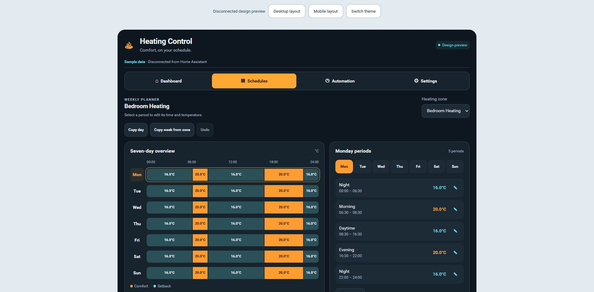
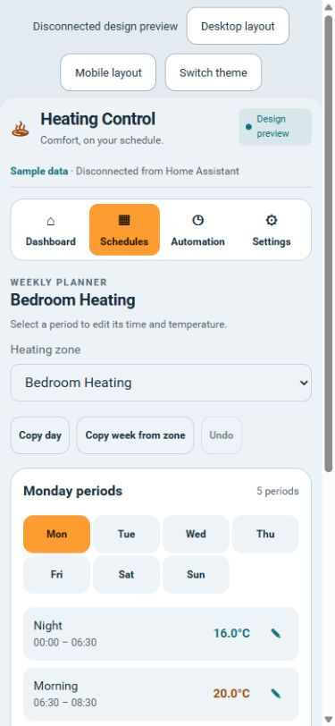
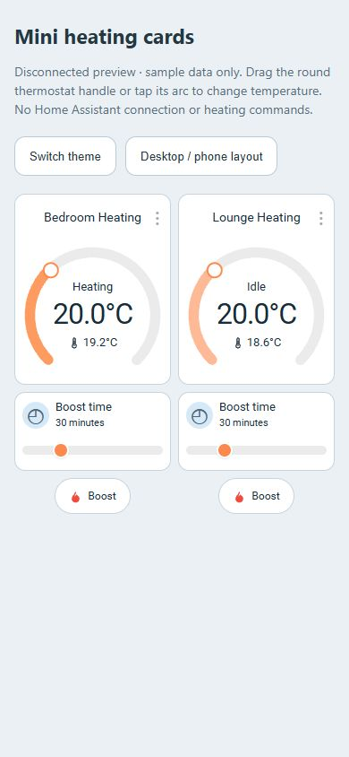

# Smart Heating Scheduler

A Home Assistant custom integration for weekly heating schedules, timed boost, occupancy overrides, holidays, calendar/Workday profiles and local heating history, with a companion Lovelace card. Optional smart preheating learns a measured warm-up rate for each zone.

**Stable release 0.5.3:** install both the [integration](https://github.com/OneScuzzie2k/smart-heating-scheduler/releases/tag/0.5.3) and [companion card](https://github.com/OneScuzzie2k/smart-heating-scheduler-card/releases/tag/0.5.3). Including pre-releases is not required. See the [acceptance results and limits](docs/RELEASE_ACCEPTANCE.md) and [profiles/history/preheating guide](docs/PROFILES_HISTORY_PREHEATING.md).

**[Installation and setup guide](docs/INSTALLATION.md)** - install both packages, add zones, configure the card and move from observe-only to heating control.

Requires **Home Assistant Core 2026.11.1 or newer** and an existing available, single-target `climate` entity supporting heating. On this supported HA version, use **Settings > Marketplace**. The repositories use the HACS-compatible format; older HA/HACS installations are outside the current supported baseline. The integration is shown in HA as **Smart Heating Scheduler**. Older installations may retain their previous entry name.

No separate add-on, third-party scheduler card, Node.js or user-installed Python package is needed to run it. Your thermostat/device integration remains required. Existing boost scripts/helpers are optional: choose built-in boost if you do not use them.

Development branch only: `0.6.0-dev.3` adds guarded Hive/ZHA receiver scheduling with configurable HA preheating and occupancy overrides. It requires per-receiver clock/transition/timer qualification and explicit handover; no automatic migration. [Receiver setup and limits](docs/receiver-scheduling.md).

New installations start in **observe only**. Heating control is a separate administrator action after reviewing every enabled zone.

## New in 0.5.3

Guided zone setup, optional frost protection, schedule/settings backup and import, and clearer preheating feedback. New guided zones start disabled. [Read the setup and recovery guide](docs/SETUP_FROST_BACKUPS.md).

## Screenshots

The companion card on desktop and phone. These screenshots use sample data from the working 0.3.0 card, disconnected from Home Assistant.

**Desktop weekly planner**



| Mobile schedule editor | Mini thermostat and boost cards |
| --- | --- |
|  |  |

[View the full dashboard screenshot](docs/screenshots/dashboard-desktop.jpg). Both full and mini layouts are included in the [companion card](https://github.com/OneScuzzie2k/smart-heating-scheduler-card).

## Working features

- Optional calendar/Workday day profiles with ordered rules and weekly fallback.
- Seven-day temperature/decision history with compact 1-hour, 24-hour and 7-day views.
- Opt-in measured preheating with learning thresholds, a configurable early-start cap and existing override priority. Timing accuracy still needs validation over real heating cycles.

- Reviewed per-zone thermostat mappings, limits, units and seven-day schedules.
- Persistent manual holds, weekly revisions, DST-aware boundaries and event/deadline-driven evaluation.
- Built-in timed boost with absolute restart deadlines, cancel, and return-to-Off behaviour.
- Generic external boost adapter with awaited start/cancel scripts, fixed target declaration, timer ownership, optional duration helper and filtered completion signal.
- Explicit presence entities/state meanings, any/all logic, configurable delays, unknown grace/fallback, expiring Home/Away overrides and optional occupied comfort minimum.
- Per-zone holiday dates/targets and acknowledged built-in boost exceptions; current-rule resumption on return.
- Administrator-only configuration, thermostat-permission-checked household boost, permission-filtered card subscriptions, stale policy/schedule rejection, minimal diagnostics and three status sensors per zone.
- Optional serialized/throttled climate commands with three-attempt limits, availability guards and explicit handover faults.

Read [control policies](docs/CONTROL_POLICIES.md) for priority, configuration, adapter contracts, restart handling and remaining limitations. No home-specific IDs or policies are bundled. Targets are entered in the chosen climate unit; no Celsius default is imposed on Fahrenheit installations.

## Testing

For backend development, use an isolated HA instance with simulated entities. API tests use real HA 2026.11.1 objects and simulated states. A supervised two-zone installation has also exercised schedule transitions, manual targets, occupancy activation, natural external boost expiry, holidays and Core restart recovery. Active external boosts recovered and expired at their original deadlines with timer restoration enabled. This does not establish compatibility with every thermostat; see [acceptance scope](docs/RELEASE_ACCEPTANCE.md).

```powershell
$env:PYTEST_DISABLE_PLUGIN_AUTOLOAD='1'
python -m pytest
python -m unittest tests.ha.test_runtime -v
```

The HA test command requires Python >=3.14.2 with homeassistant==2026.11.1; standalone logic tests also run on Python 3.13. Restricted Windows environments may need permission for asyncio's internal loopback socket. See VALIDATION.txt for the actual checks and outstanding work.

## Install through Marketplace

1. Open **Settings > Marketplace > Add from link** and add this repository as an **Integration**:
   `https://github.com/OneScuzzie2k/smart-heating-scheduler`.
2. Select stable integration version **0.5.3** and install. Follow any restart prompt. Including pre-releases is not required.
3. Add the [companion card repository](https://github.com/OneScuzzie2k/smart-heating-scheduler-card) the same way as a **Dashboard** item; select **0.5.3** and reload your browser after installation.
4. Open **Settings > Devices & services > Add integration**, search for **Smart Heating Scheduler** and complete setup. Open its integration entry and choose **Add heating zone** for each thermostat.
5. Add **Smart Heating Scheduler** from your dashboard's card picker, select the scheduler and build your weekly schedules while still in observe-only mode.

**[Continue with the full setup and handover instructions](docs/INSTALLATION.md)**, including manual installation, the mini card, boost adapters, occupancy, updates and rollback. Installing the files alone does not enable heating control.


## Distribution status

Published public GitHub releases, available as custom Marketplace repositories. Catalog inclusion is pending. Full bootstrap/config-flow coverage, more heating hardware, inheritance/bulk configuration, import/export, accessibility and translations remain follow-up work. Existing entry names are preserved; the card reports actual control mode. Guided zone setup and optional frost protection are included in 0.5.3; see [setup, frost and backup guidance](docs/SETUP_FROST_BACKUPS.md). MIT licensed. Public packages exclude home-specific audit and handover files.

## Household boost permissions

Non-administrators can start and stop boost and choose its duration/target in the full or mini card when their Home Assistant account can read and control the mapped thermostat. Schedules, occupancy/holiday rules, heating handover and settings remain administrator-only. External boost adapters also require control permission on the configured start/cancel scripts and optional duration helper. Install both integration and card 0.5.3, restart Home Assistant, then reload the browser/Companion app frontend. No administrator promotion is needed.
